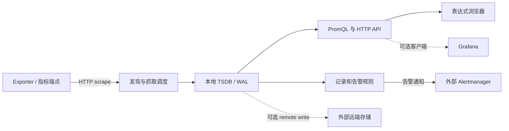

# Prometheus

**指标采集、时序存储、PromQL 查询与规则评估的重建配方。**

[](https://github.com/recipkg/recipkg)
[](https://github.com/prometheus/prometheus/tree/bae3eced0a5369e050e83ea73bc381d7c4b1a719)
[](COVERAGE.md)
[](SOURCES.md)

## 工作流



## 配方范围

目标是固定版本 Prometheus Server 与 `promtool` 的可观察行为。Alertmanager、Grafana、exporter、Pushgateway 与远端存储都作为独立外部组件处理。

```sh
recipkg check .
recipkg pack . -o prometheus-0.1.0.recipe.tar.gz
recipkg check prometheus-0.1.0.recipe.tar.gz
```

阅读 [配方](RECIPE.md)、[完整重建提示词](BUILD_PROMPT.md)、[验收计划](ACCEPTANCE.md)、[覆盖状态](COVERAGE.md) 和 [来源](SOURCES.md)。打包检查只验证配方材料与递归依赖，不代表 Prometheus 已重建。
